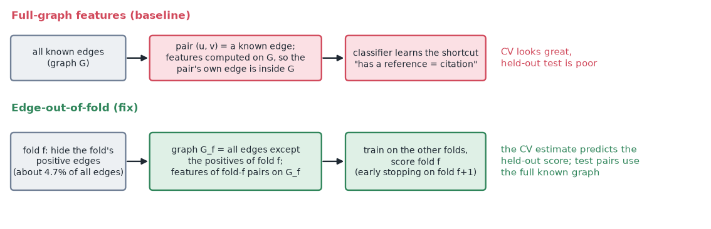

# Citation Prediction on a Scholarly Knowledge Graph

Predict whether one research paper cites another. The data is modelled as a small **knowledge graph** of papers, authors and abstracts connected by citation and authorship relations; features are extracted from the graph and from the text, and a LightGBM classifier turns them into calibrated citation probabilities. Text features use TF-IDF and SBERT Transformer embeddings; graph features include neighbourhood overlaps, PageRank, SVD embeddings and an author-to-author citation prior.

**Tags:** `knowledge-graph` · `nlp` · `link-prediction` · `citation-prediction` · `graph-machine-learning` · `sentence-transformers` · `sbert` · `tf-idf` · `lightgbm` · `feature-engineering` · `scikit-learn` · `kaggle` · `python`

> **Background.** The project comes from a Kaggle challenge of a university *Natural Language Processing* course: predict citations on a network of 138,499 papers, scored by log loss. This repository is the polished version: the pipeline is organised as a tested package, a bug in how training features were built is fixed, and further features are added and measured.

## The knowledge graph

```
(Author) --wrote--> (Paper) --cites--> (Paper)
                       |
                  has_abstract --> text
```

| Real data | Value |
|---|---|
| Paper nodes / author nodes | 138,499 / 149,682 |
| `cites` edges / `wrote` edges | 1,091,955 / 456,810 |
| Mean references per paper | 7.9 (27.6% of papers have none in the data) |
| Mean authors per paper | 3.3 |

It is deliberately a simple graph (papers, authors, abstracts, citations; no venues, years or institutions), but every feature is a question asked of it: how many references does a paper have, do two papers share an author, how similar are the abstracts, have the authors of *u* cited the authors of *v* before. `citepred.kg` makes the graph explicit (typed edges, summary statistics, triple export).

## A fixed bug: training features that saw the answer



A graph feature such as "out-degree of the citing paper" is computed on the graph. If that graph still contains the very edge being predicted, the feature partly encodes the answer, whereas the test pairs are citations that were **hidden** from the graph. The baseline notebook built its training features this way, which is why its cross-validation score (0.112) was far better than its competition score (0.214). The polished pipeline uses an **edge-out-of-fold** construction: each training pair's graph features are computed on a graph that does not contain its edge, exactly like a hidden test pair.

## Documentation

| File | Content |
|---|---|
| [`docs/Project_Scope_and_Aims.pdf`](docs/Project_Scope_and_Aims.pdf) | The task, the knowledge-graph model of the data, the aims, the approach and what is out of scope. |
| [`docs/Implementation_Guide.pdf`](docs/Implementation_Guide.pdf) | How the package works (graph, features, embeddings, model, training-set construction), the tests, every result with caveats, and limitations. |
| [`notebooks/citation_prediction.ipynb`](notebooks/citation_prediction.ipynb) | The notebook, executed on a synthetic network (runs anywhere; uses the real data automatically if you provide it). |

## Results

All scores are **held-out scores on hidden real edges** ("pseudo-test split": as many real citations as the test set has positives are removed from the graph, equal numbers of random non-edges are added, and the model is scored on them). They are *not* leaderboard scores; the competition labels are secret.

**1. Adding features (edge-out-of-fold training):**

| Step | Held-out log loss |
|---|---|
| baseline: the nine original features | 0.1336 |
| + all degree and neighbourhood measures | 0.1307 |
| + PageRank | 0.1219 |
| + TF-IDF text similarity | 0.1071 |
| + author citation prior | 0.1009 |
| + graph-aware SBERT features | 0.0838 |
| + SVD embedding | 0.0823 |
| all features, final model settings | **0.0814** (AUC 0.9956) |

The most valuable new idea was combining text with structure: *how similar is the candidate to the papers the citing paper already cites?* Leave-one-group-out results, calibration and error analysis are in the implementation guide.


**2. The fixed bug, with the nine original features:**

| Training-set construction | Cross-validation log loss | Held-out log loss |
|---|---|---|
| features on the full graph (baseline) | 0.127 | **0.226** |
| edge-out-of-fold (fixed) | 0.137 | **0.133** |

With the fix, the cross-validation estimate predicts the held-out score; without it, it is far too optimistic (compare 0.112 against 0.214 for the baseline notebook on the real competition).

## Quick start

```bash
pip install -e .[sbert,dev]                 # Python 3.10+
python -m citepred demo                     # both constructions on a synthetic network, no data needed
python -m unittest discover -s tests -t .   # 31 tests, about 35 seconds
```

Example output of the demo (synthetic network, held-out hidden edges):

```
                           run  protocol  features  cv_logloss  cv_auc  test_logloss  test_auc
full-graph features (baseline)     leaky        26      0.0792  0.9948        0.4733    0.9578
 edge-out-of-fold (this fix)  leak-free        26      0.1873  0.9782        0.1960    0.9770
```

### On the real challenge data

The Kaggle data is not included. Put `edgelist.txt`, `abstracts.txt`, `authors.txt` and `test.txt` in a folder and either run the notebook with `CITEPRED_DATA=<folder>` or the script:

```bash
python scripts/run_real.py --data-dir DIR --embeddings embeddings.npy --submission submission.csv
```

SBERT embeddings are produced (and cached in resumable chunks) by `citepred.embed.embed_abstracts`; on a 2-core CPU they take about 78 minutes for 138k abstracts at a 128-token limit. The script writes only aggregate numbers to `results/real_data_results.json`.

## What is in the package

| Module | Content |
|---|---|
| `citepred.kg` | the knowledge graph: typed `cites` / `wrote` edges, statistics, triple export |
| `citepred.graph` | sparse-matrix degrees, bibliographic coupling, co-citation, common neighbours, Jaccard, Adamic-Adar, resource allocation, two-hop paths, PageRank, truncated SVD |
| `citepred.text` | TF-IDF and SBERT cosine; graph-aware embedding features |
| `citepred.authors` | shared authors; author-to-author citation prior |
| `citepred.protocol` | seeded negative sampling, folds, the edge-out-of-fold (and the baseline full-graph) training-set construction |
| `citepred.model`, `citepred.pipeline` | LightGBM cross-validation, calibration, pseudo-test split, ablation helpers |
| `citepred.embed` | resumable chunked SBERT embedding |
| `citepred.synthetic` | a synthetic citation network with labelled hidden test pairs |

Every graph feature is verified against `networkx` or plain set arithmetic, and the central property of the training-set construction (a fold's graph never contains its own positive edges) is tested directly.

## Repository layout

```
src/citepred/     the package
tests/            31 unit tests
notebooks/        citation_prediction.ipynb (executed on synthetic data)
scripts/          run_real.py (real-data experiments), make_figures.py
results/          real_data_results.json (aggregates only) and figures
docs/             the two PDF guides
```

## Limitations

* Held-out scores, not leaderboard scores; they are faithful only if the real test set was built from hidden edges plus random pairs, which the data checks support but cannot prove.
* The knowledge graph is simple: no venues, years, institutions or author disambiguation, and no graph neural networks.
* Negatives are uniformly random pairs; hard negatives (similar papers that do not cite each other) are not studied.
* Author names are matched exactly as written. Abstracts are truncated to 128 word pieces for the SBERT embeddings.
* The dataset's paper-id order carries direction information; it is a numbering artefact, so it is excluded from the model (adding it would change the held-out log loss by about 0.003).
* On Windows, PyTorch and LightGBM can conflict over OpenMP; the package sets Intel's documented `KMP_DUPLICATE_LIB_OK` workaround (unsupported by Intel; the tests check the numerical results).

## License

MIT, see [`LICENSE`](LICENSE). © 2026 Evangelos Tempelopoulos.
