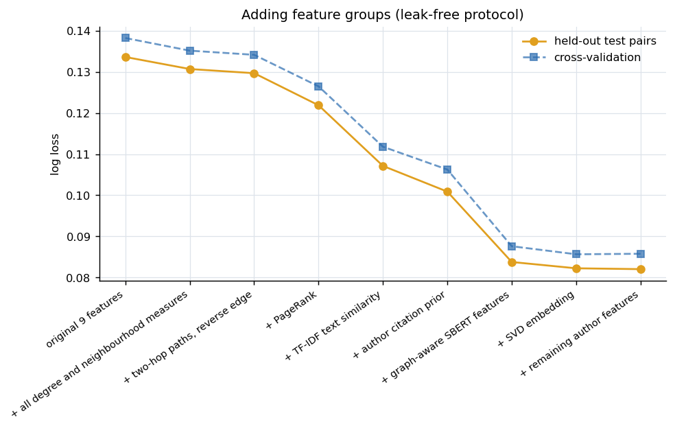

# Citation Prediction: a leakage-free link-prediction pipeline

Predict whether one research paper cites another, from abstracts, authors and a partly observed citation network. The project is about doing this **honestly**: it finds and removes a data leak that made cross-validation scores meaningless, then uses a trustworthy estimate to add and evaluate features (TF-IDF, SBERT Transformer embeddings, PageRank, SVD embeddings, author citation prior) in a LightGBM classifier.

**Tags:** `nlp` · `link-prediction` · `citation-prediction` · `graph-machine-learning` · `sentence-transformers` · `sbert` · `tf-idf` · `lightgbm` · `feature-engineering` · `data-leakage` · `scikit-learn` · `kaggle` · `python`

> **Background.** This project is based on a Kaggle challenge of a university *Natural Language Processing* course (citation prediction on a network of 138,499 papers, scored by log loss). A first notebook for the challenge reported an out-of-fold log loss of 0.112 but scored 0.214 on the competition. This repository explains that gap, fixes it, and rebuilds the pipeline as a tested package plus an improved notebook.

## The idea in one picture


A graph feature such as "out-degree of the citing paper" is computed on the graph. If that graph still contains the very edge you are trying to predict, the feature partly encodes the answer. The test set, however, consists of citations that were **hidden** from the graph. The **edge-out-of-fold** protocol computes each training pair's features on a graph that does not contain its edge, exactly like a hidden test pair.

## Documentation

| File | Content |
|---|---|
| [`docs/Project_Scope_and_Aims.pdf`](docs/Project_Scope_and_Aims.pdf) | What the task is, why the first notebook's score was misleading, the research questions, the approach, and what is out of scope. |
| [`docs/Implementation_Guide.pdf`](docs/Implementation_Guide.pdf) | How the package works (protocol, features, embeddings, model), the tests, every result with caveats, and limitations. |
| [`notebooks/citation_prediction.ipynb`](notebooks/citation_prediction.ipynb) | The improved notebook, executed on a synthetic network (runs anywhere; uses the real data automatically if you provide it). |

## Results

All scores are **held-out scores on hidden real edges** ("pseudo-test split": as many real citations as the test set has positives are removed from the graph, equal numbers of random non-edges are added, and the model is scored on them). They are *not* leaderboard scores; the competition labels are secret.

**1. The leak, with the original nine features:**

| Protocol | Cross-validation log loss | Held-out log loss |
|---|---|---|
| leaky (features on the full graph) | 0.127 | **0.226** |
| leak-free (edge-out-of-fold) | 0.137 | **0.133** |

The leaky protocol's estimate is far too optimistic; the leak-free estimate predicts the held-out score. (For comparison, the first notebook scored 0.214 on the real competition.)

**2. Adding features (leak-free):**

| Step | Held-out log loss |
|---|---|
| original 9 features | 0.1336 |
| + all degree and neighbourhood measures | 0.1307 |
| + PageRank | 0.1219 |
| + TF-IDF text similarity | 0.1071 |
| + author citation prior | 0.1009 |
| + graph-aware SBERT features | 0.0838 |
| + SVD embedding | 0.0823 |
| all features, final model settings | **0.0814** (AUC 0.9956) |

The most valuable new idea was combining text with structure: *how similar is the candidate to the papers the citing paper already cites?* Details, leave-one-group-out results, calibration and error analysis are in the implementation guide.



## Quick start

```bash
pip install -e .[sbert,dev]                 # Python 3.10+
python -m citepred demo                     # leaky vs leak-free on a synthetic network, no data needed
python -m unittest discover -s tests -t .   # 28 tests, about 35 seconds
```

Example output of the demo (synthetic network, held-out hidden edges):

```
                      run  protocol  features  cv_logloss  cv_auc  test_logloss  test_auc
leaky (original protocol)     leaky        26      0.0792  0.9948        0.4733    0.9578
 leak-free (this project) leak-free        26      0.1873  0.9782        0.1960    0.9770
```

### On the real challenge data

The Kaggle data is not included. Put `edgelist.txt`, `abstracts.txt`, `authors.txt` and `test.txt` in a folder and either run the notebook with `CITEPRED_DATA=<folder>` or the script:

```bash
python scripts/run_real.py --data-dir DIR --embeddings embeddings.npy --submission submission.csv
```

SBERT embeddings are produced (and cached in resumable chunks) by `citepred.embed.embed_abstracts`; on a 2-core CPU they take about 78 minutes for 138k abstracts at a 128-token limit. The script writes only aggregate numbers to `results/real_data_results.json`.

## What is in the package

| Module | Content |
|---|---|
| `citepred.graph` | sparse-matrix degrees, bibliographic coupling, co-citation, common neighbours, Jaccard, Adamic-Adar, resource allocation, two-hop paths, PageRank, truncated SVD |
| `citepred.text` | TF-IDF and SBERT cosine; graph-aware embedding features |
| `citepred.authors` | shared authors; author-to-author citation prior |
| `citepred.protocol` | seeded negative sampling, folds, the **leak-free** (and the leaky) training-set construction |
| `citepred.model`, `citepred.pipeline` | LightGBM cross-validation, calibration, pseudo-test split, ablation helpers |
| `citepred.embed` | resumable chunked SBERT embedding |
| `citepred.synthetic` | a synthetic citation network with labelled hidden test pairs |

Every graph feature is verified against `networkx` or plain set arithmetic, and the protocol's central property (a fold's graph never contains its own positive edges) is tested directly.

## Repository layout

```
src/citepred/     the package
tests/            28 unit tests
notebooks/        citation_prediction.ipynb (executed on synthetic data)
scripts/          run_real.py (real-data experiments), make_figures.py
results/          real_data_results.json (aggregates only) and figures
docs/             the two PDF guides
```

## Limitations

* Held-out scores, not leaderboard scores; they are faithful only if the real test set was built from hidden edges plus random pairs, which the data checks support but cannot prove.
* Negatives are uniformly random pairs; hard negatives (similar papers that do not cite each other) are not studied.
* Author names are matched exactly as written. Abstracts are truncated to 128 word pieces for the SBERT embeddings.
* The dataset's paper-id order carries direction information; it is a numbering artefact, so it is excluded from the model (adding it would change the held-out log loss by about 0.003).
* On Windows, PyTorch and LightGBM can conflict over OpenMP; the package sets Intel's documented `KMP_DUPLICATE_LIB_OK` workaround (unsupported by Intel; the tests check the numerical results).

## License

MIT, see [`LICENSE`](LICENSE). © 2026 Evangelos Tempelopoulos.
